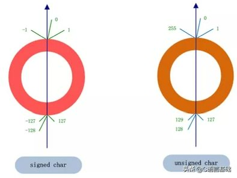

## 任务 1.1：

**1. 如果该寄存器按无符号整数解析，这杯奶茶的甜度值是多少？**
*   二进制 1001 1100 按无符号整数
    计算： 128 + 16 + 8 + 4 = 156

**2. 如果老板要求该寄存器按有符号补码整数解析，此时的甜度值是多少？**
*   答案：-100
*   过程：二进制 1001 1100 的符号位是 1，表示这是一个负数。要求其十进制值，需要按位取反再加 1
    *   取反：0110 0011
    *   加 1：0110 0100 （即十进制的 64+32+4=100）

**3. 为什么现在的计算机底层清一色都采用“补码”来存储有符号数，而不是直观的“原码”或“反码”？**
  * 
    1.  **统一了 0 的表示：** 原码和反码中，0 有“+0”和“-0”两种表示方式，而补码中 0 只有唯一的一种表示（全 0），这使得判断是否为 0 更加简单，也节省了一个编码状态。
    2.  **简化了硬件设计：** 采用补码后，**减法运算可以转换为加法运算**（\(A - B = A + (-B)\)）。这样 CPU 的算术逻辑单元（ALU）只需要设计加法器即可，无需专门设计减法器，大大降低了硬件成本，提高了运算效率。
    3.  **多表示一个负数：** 在同等位数下，补码能比原码和反码多表示一个最小负数（例如 8 位补码可以表示 -128，而原码只能表示到 -127）。

---

## 任务 1.2：

*   **输出结果：**
    ```text
    [警告!] 温度过高! 触发消防喷淋系统!
    ```

*   **原因**
    代码中存在一个隐式类型转换

    在 `if (current_temp < warning_temp)` 这行代码中，`current_temp` 是**有符号整数 (int)**，值为 `-10`；而 `warning_temp` 是**无符号整数 (unsigned int)**，值为 `50`。

    根据 《深入理解计算机系统》CS:APP ，当一个有符号数与一个无符号数进行运算或比较时，C 语言会隐式地将这个有符号数强制转换为无符号数。然后再去比

    由于-10 的补码表示是 `11111111 11111111 11111111 11110110`(还是先取反再加1，具体过程省略了)。当它被强行解释为无符号数时，。这个转成无符号十进制数就是 2的32次方-10，具体原理我经过查找资料了解到，无符号数和有符号数的转换就是两套刻在圆盘上的标度的对应转换，下面附图：（ps 这里以char，举例，实际 **原理是一样的只是大小不同**）
    

    所以，实际运行的比较逻辑变成了：
    `if (4294967286 < 50)` —— 这个条件显然是**False** 

    要解决这个问题，必须进行显式的强制类型转换，例如 `if (current_temp < (int)warning_temp)` 即可。