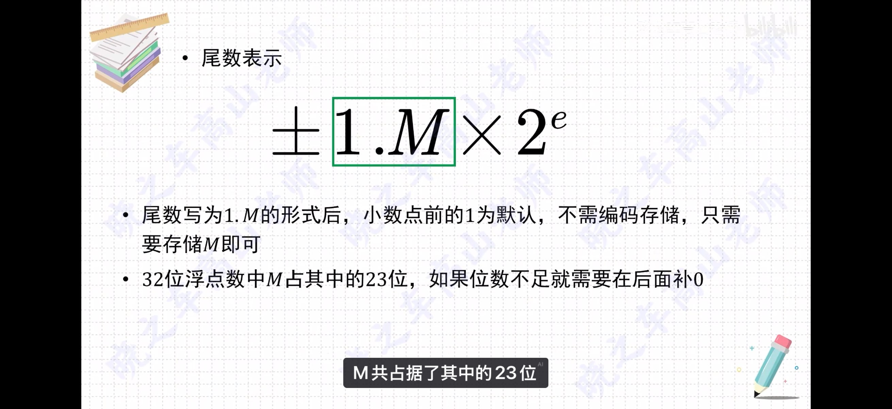
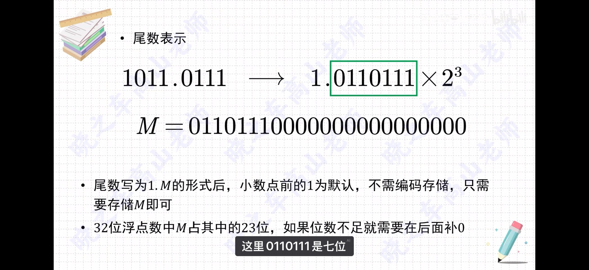
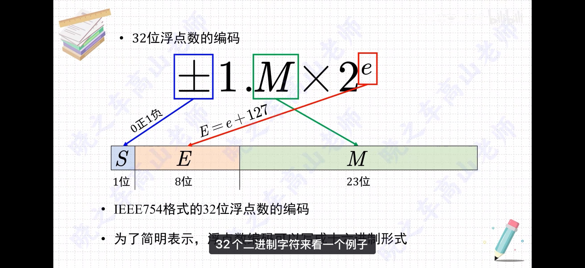
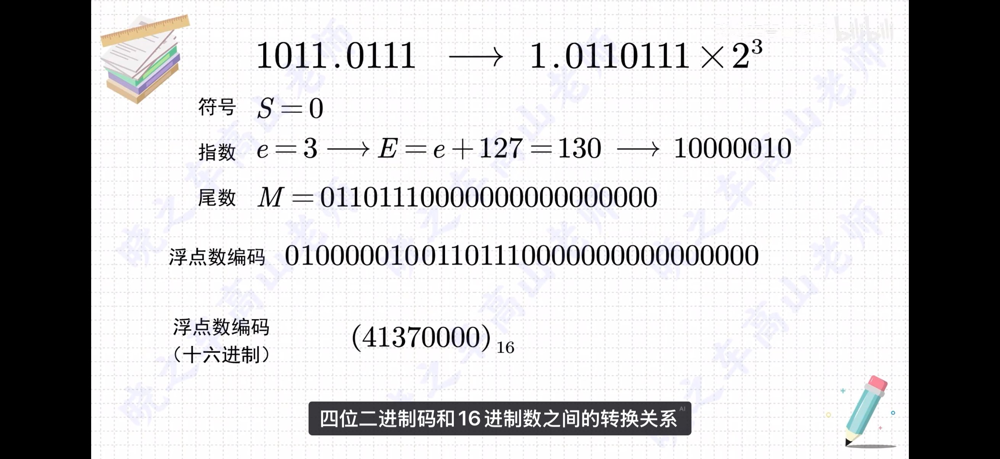
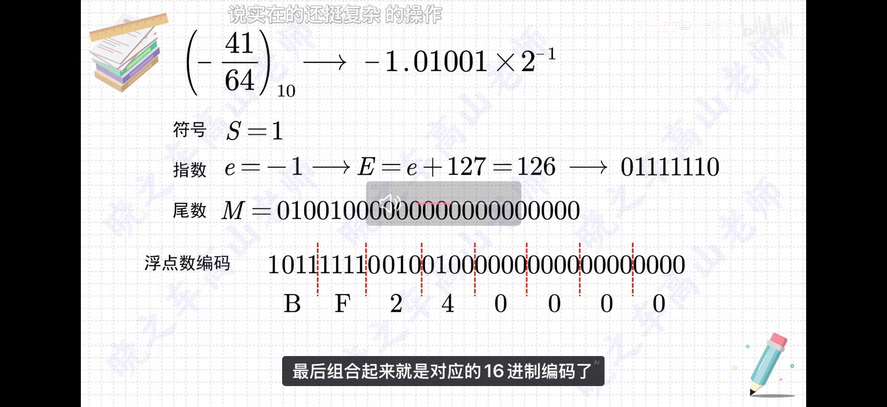
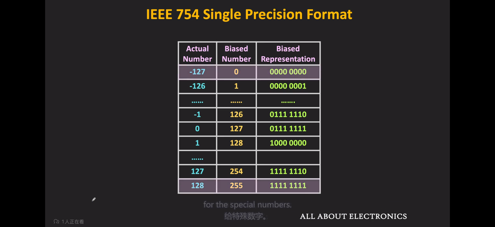
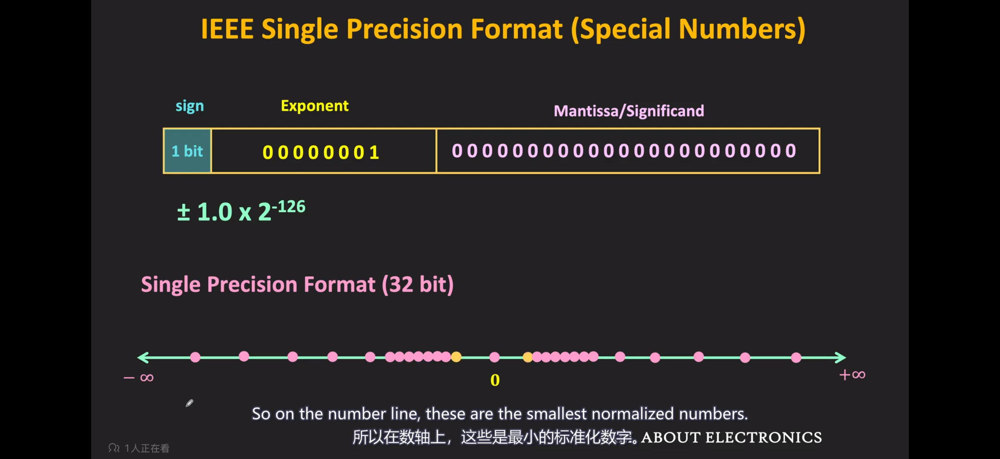
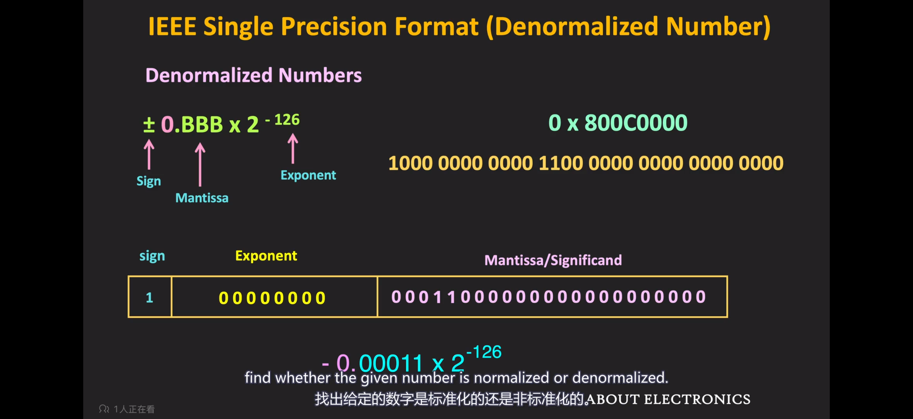
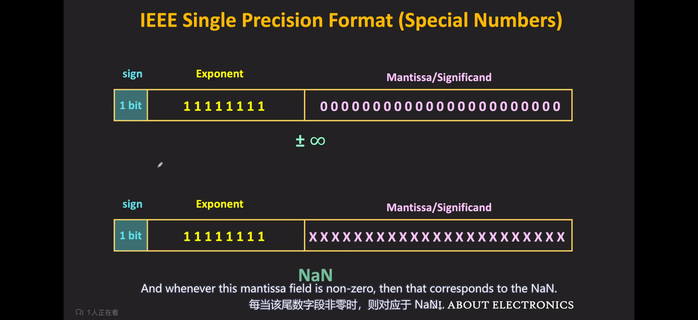
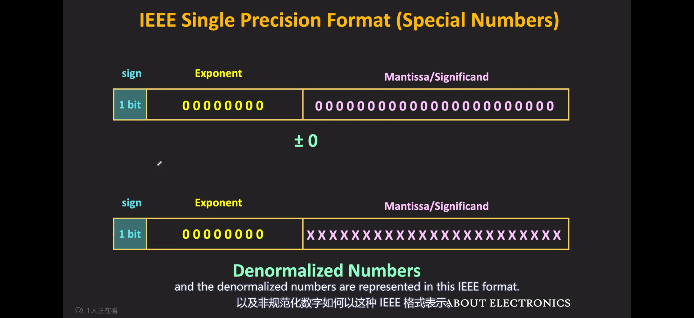

# Step3: 丝滑配比阀 —— 认识 IEEE 754 标准下的浮点数

## 任务 3.1：

**1. 在 IEEE 754 标准中，float 与 double 分别使用多少位来表示这三部分？**

*   **单精度浮点数 (float, 32位):**
    *   符号位 (sign)：1 位
    *   阶码 (exponent)：8 位
    *   尾数 (significand)：23 位
*   **双精度浮点数 (double, 64位):**
    *   符号位 (sign)：1 位
    *   阶码 (exponent)：11 位
    *   尾数 (significand)：52 位

**2. 偏置值 (Bias) 是如何计算的？这样做的意义是什么？**

*   **计算方法：** 偏置值的计算公式为 2（k-1） - 1，其中 k 是阶码的位数。例如，对于单精度 (8位阶码)，Bias = 2（8-1） - 1 = 127；对于双精度 (11位阶码)，Bias = 2（11-1） - 1 = 1023。
*   **意义：** 
    1.  **便于比较大小：** 将原本有正有负的阶码加上一个偏置值后，转换为无符号整数。这样，在比较两个浮点数大小时，可以直接按位比较，
    2.  **统一了 0 的表示：** 避免了使用补码表示阶码时可能出现的 +0 和 -0 两种表示方式。
    3.  参考资料：
                  
                 
                 
                 

**3. 非规格化数的特点是什么？**

*   **阶码全为 0：** 非规格化数的阶码字段 (E) 所有位均为 0。
*   **尾数非 0：** 尾数字段 (M) 不全为 0（如果全为 0 则代表 0）。
*   **隐含位为 0：** 规格化数的尾数隐含整数位 1即 1.M，而非规格化数的尾数隐含整数位 0，即 0.M。
*   **实际阶码固定：** 其实际阶码值固定为 1 - Bias而不是 0 - Bias。（这里是-126，规格化数最小为1*2^-126，跟小的就需要非规格化数了
*   **作用：** 用于表示非常接近于 0 的极小数值，实现了从最大非规格化数到最小规格化数的平滑过渡（渐进式下溢）。
*   **ps** 规格数是E=e+127，但为了和规格数无缝衔接，要移动下位使0.M，所以非规格数的阶码全为0，但是表示的不是-127次方而是固定的-126次方，这一点比较特殊，

**4. 两个特殊阶码模式分别指的是什么？**

1.  **阶码全为 1 且尾数全为 0：** 表示 **无穷大 (Infinity)**。根据符号位的不同，分为正无穷和负无穷
2.  **阶码全为 1 且尾数非 0：** 表示 **非数值 (NaN, Not a Number)**。通常用于表示未定义或非法的运算结果。
3.  **ps** 相当于把阶码全1从规格化数中抠出来专门拿来表示一些特殊情况

## 参考资料：《深入了解计算机系统》& 印度老哥讲解

---

## 任务 3.2：补全浮点数对照表

根据题目给出的 8 位迷你浮点数格式：
*   **符号位 S：** 1 位 (第 7 位)
*   **阶码位 E：** 4 位 (第 6~3 位)，偏置值 Bias = 7
*   **尾数位 M：** 3 位 (第 2~0 位)

对照表补全如下：

| 二进制位模式 | 编码类型 (规格化/非规格化/特殊值) | 实际阶码 e (十进制) | 尾数真值 M (二进制小数) | 十进制最终真值 |
| :--- | :--- | :--- | :--- | :--- |
| `0 0110 100` | 规格化 | 6 - 7 = -1 | 1.100_2 = 1.5 | 1.5* 2^{-1} = 0.75 |
| `0 0000 011` | **(A) 非规格化** | **(B) 1 - 7 = -6** | **(C) 0.011_2 = 0.375** | **(D) 0.375 * 2^{-6} = 0.005859375** |
| `0 1111 000` | **(E) 特殊值 (正无穷)** | 不适用 | 不适用 |  (正无穷) |
| `0 1001 010` | 规格化 | **(F) 9 - 7 = 2** | **(G) 1.010_2 = 1.25** | **(H) 1.25* 2^2 = 5.0** |

*(ps：对于 `0 0000 011`，阶码全为0且尾数非0，属于非规格化数。其实际阶码固定为 1-Bias = 1-7 = -6，尾数隐含位为0，即 0.011_2 = 0.375。最终值为 0.375* 2^{-6} = 0.005859375)*
*(pps: 这几个空比较简单就不写思考过程了)*

---

## 任务 3.3：

**1. 该 8 位浮点数能表示的最小的正非规格化数的二进制位模式是什么？对应的十进制数值是多少？最大的呢？**

*   **最小的正非规格化数：**
    *   二进制模式：`0 0000 001` (符号位0，阶码全0，尾数最小非0)
    *   十进制数值：0.001_2 * 2（1-7） = 0.001953125
*   **最大的正非规格化数：**
    *   二进制模式：`0 0000 111` (符号位0，阶码全0，尾数全1)
    *   十进制数值：0.111_2 * 2^{-6} = 0.013671875

**2. 阀门全开时，该 8 位浮点数能表示的最大的正规格化数的二进制位模式是什么？对应的十进制数值是多少？最小的呢？**

*   **最大的正规格化数：**
    *   二进制模式：`0 1110 111` (ps:这里一定注意！阶码不能全为1，最大为1110；尾数全1,因为全1拿去表示特殊情况了)
    *   十进制数值：1.111_2 * 2（14-7） = 240
*   **最小的正规格化数：**
    *   二进制模式：`0 0001 000` (阶码最小非0为0001，尾数全0)
    *   十进制数值：1.000_2 * 2（1-7） = 0.015625

**3. 比较最大正非规格化数和最小正规格化数，思考对于非规格化形式，阶码值为什么是 1 - Bias 而不是简单的 -Bias？**

*   最大的正非规格化数是 0.111_2 * 2^{-6}，最小的正规格化数是 1.000_2 * 2^{-6}。
*   如果非规格化数的阶码是简单的 -Bias (即 -7)，那么：
    *   最大非规格化数 = 0.111_2 * 2^{-7} = 1.75 * 2^{-8} （大约为 0.0068）
    *   最小规格化数 = 1.000_2 * 2^{-6} = 1 * 2^{-6} = 0.015625
    *   这两个数之间存在一个巨大的“断层”，不连续。
*   将非规格化数的实际阶码设为 **1 - Bias** (即 -6)，使得：
    *   最大非规格化数 = 0.111_2 * 2^{-6} = 1.75 * 2^{-7}
    *   最小规格化数 = 1.000_2 * 2^{-6} = 1 * 2^{-6} = 2 * 2^{-7}
    *   此时，最大非规格化数加上其最小精度 (即 2^{-9})，正好等于最小规格化数。这种设计实现了从非规格化数到规格化数的**平滑过渡 (渐进式下溢)**，保证了数值在靠近 0 的极小范围内不会出现精度丢失的断层。