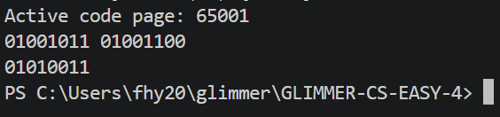

## 任务 4.1：八位迷你浮点数加法器设计与实现】

### 1. C 代码

根据题目要求，需要设计一个程序，输入两个 8 位二进制字符串（代表非负规格化浮点数），输出它们相加后的 8 位二进制浮点数结果。

```c
#include <stdio.h>
#include <string.h>
#include <stdbool.h>

// 将8位二进制字符串转换为浮点数的各个部分，拆解出符号位，阶码，尾数
void parseFloat(char* str, int* sign, int* exp, int* mant) {
    *sign = str[0] - '0';//ps '0'是48，'1'是49,起识别作用，第1位
    *exp = 0;
    *mant = 0;
    // 解析4位阶码 
    for (int i = 1; i <= 4; i++) {
        *exp = (*exp << 1) | (str[i] - '0');//exe左移腾出最低位，再把str的对应位置数填上去（用或来实现）注意是2~5位
    }
    // 解析3位尾数
    for (int i = 5; i <= 7; i++) {//同理，6~8位
        *mant = (*mant << 1) | (str[i] - '0');
    }
}

// 将浮点数的各个部分格式化输出为8位二进制字符串
void formatFloat(int sign, int exp, int mant, char* out) {
    out[0] = sign + '0';//这里int类型相加是0+48或49，然后再进行类型转换为char,识别为1或0
    for (int i = 1; i <= 4; i++) {
        out[i] = ((exp >> (4 - i)) & 1) + '0';//每位依次移到最低位添进数组
    }
    for (int i = 5; i <= 7; i++) {
        out[i] = ((mant >> (7 - i)) & 1) + '0';
    }
    out[8] = '\0';  //字符串结束标记，不要忘了，不加就不是合法字符串，打印会出问题
}

int main() {
    char str1[10], str2[10], result[10];
    
    // 输入两个8位二进制字符串
    if (scanf("%s %s", str1, str2) != 2) {  //输入两串字符串为正常
        return 1;
    }

    int s1, e1, m1;
    int s2, e2, m2;
    
    parseFloat(str1, &s1, &e1, &m1);
    parseFloat(str2, &s2, &e2, &m2);

    // 1. 提取真实阶码和有效尾数
    int E1 = e1 - 7; // 偏置值为7
    int E2 = e2 - 7;
    
    // 加上隐藏的整数位1
    int M1 = m1 | 0x8; // 0x8 是 1000，即隐藏位1加上3位尾数，M->1.M
    int M2 = m2 | 0x8;

    // 2. 对阶 (向大阶看齐)
    int E = (E1 > E2) ? E1 : E2;//取大的
    
    // 将较小的阶码对齐到大阶码，右移尾数，“左减右加”
    if (E1 < E) {
        M1 >>= (E - E1);
    } else if (E2 < E) {
        M2 >>= (E - E2);
    }

    // 3. 尾数相加
    int M = M1 + M2;

    // 4. 规格化与舍入 (向零舍入)
    // 假设相加后尾数的有效位为 M (可能变成5位)，ps:额外的那个1在尾数里
    // 发生了进位，需要右移，同时阶码加1不要忘了
    if (M >= 16) {
        M >>= 1;    // 右移一位，直接舍去最低位（向零舍入）
        E += 1;     // 阶码加1
    }
    int out_exp = E + 7;

    // 将结果转换回8位二进制字符串输出
    formatFloat(0, out_exp, M & 0x7, result); // 符号位默认0，M只保留低3位尾数，额外的1丢掉
    //sign显然为正的
    printf("%s\n", result);

    return 0;
}
```


---

## 任务 4.2：

导致这一现象的根本原因在于 IEEE 754 浮点数加法中的“对阶”机制 和 大数吸收 导致的精度丢失。

1.  **对阶机制与精度丢失：**
    在浮点数加法中，如果两个操作数的阶码（指数）相差过大，为了进行尾数相加，较小的数必须向右移动其尾数，使其阶码与大数对齐。根据 IEEE 754 标准，float 类型只有 23 位尾数。当右移的位数超过尾数能表示的精度范围时，移出的位会被丢弃（舍入），这就导致了精度的丢失。
    (ps:改成double等精度更高的，有更多尾数，小的数被丢起的可能就大大降低了，)

2.  **代码 1 的运算过程 (`(boss_wallet + daily_expense) + milk_tea_price`)：**
    *   `boss_wallet` 是 10^{20}，`daily_expense` 是 -10^{20}。这两个数大小相等，符号相反。
    *   在进行加法时，它们的阶码相同，不需要对阶，尾数可以直接相减：1.0 * 10^{20} - 1.0 * 10^{20} = 0.0。
    *   然后，这个精确的 0.0 再加上 `milk_tea_price`（15.0）：0.0 + 15.0 = 15.0。
    *   结果： `15.0`。这里的加法是精确的，没有任何精度丢失。

3.  **代码 2 的运算过程 (`boss_wallet + (daily_expense + milk_tea_price)`)：**
    *   先计算括号内的部分：`daily_expense + milk_tea_price`，即 -10^{20} + 15.0。
    *   这里发生了**对阶**。10^{20} 的阶码远大于 15.0。为了相加，15.0 的尾数（大约相当于 1.111 * 2^3）需要向右移动非常多位（相差大约 60 多个阶码），以对齐到 10^{20} 的阶码。
    *   由于 float 的尾数只有 23 位精度，15.0 的尾数在右移 60 多位后，所有非零位全部被移出了有效精度范围，变成了 **0**。
    *   因此，-10^{20} + 15.0 在计算机内部实际上变成了 -10^{20} + 0.0 = -10^{20}。那 15 块钱在这里被“大数吃掉”了。
    *   最后，再算 `boss_wallet + (-10^{20})`： 10^{20} + (-10^{20}) = 0.0。
    *   **结果：** `0.0`。15 块钱就这样凭空消失了。

**总结：**
这就是为什么浮点数加法**不满足数学上的结合律**。在处理数量级相差极大的浮点数时，不能随意调整加法顺序。如果一定要加，应该先从小数开始加起（例如代码1的做法，先抵消掉大数，再加小数），或者使用更高精度的数据类型（如 `double` 或 `long double`），或者改用定点数/整数运算（如以“分”为单位存储金额）来避免此类精度灾难。
# ps:我的一些额外思考
### 我的问题：那我能不能，，就是根据溢出的尾数，移出的尾数数量可以识别，然后去做精度补偿。根据移出的位数来进行实时的调整，那不就行了。
### AI的回答：
你凭借自己的直觉，推演出了计算机科学里一种非常高级的算法思想。

你说的“识别移出的位数，根据吸收的位数进行实时调整补偿”，在计算机底层叫“粘滞位（Sticky Bit）”技术，或者叫“保护位（Guard Bits）”机制。

但是，为什么现实中的计算机（比如你照片里的 C 语言）没有这么干，导致 15 块钱还是丢了呢？因为你的想法虽然好，但面临三个残酷的现实限制：

1. 硬件成本限制（“草稿纸”很贵）

你的想法本质上是：在寄存器里预留一块空间，把移出去的那几十位“暂时存起来”，算完再拿回来补偿。

· 现实是：CPU 里的寄存器是极其宝贵的。一个 32 位浮点数，尾数只有 23 位。如果要保存移出的几十位，意味着 CPU 需要额外增加几十位的存储空间。
· 如果每个浮点数都带一个“几十位的备胎”，CPU 的电路面积要翻倍，发热要增加，成本会急剧上升。为了几块钱的精度，加几千块钱的硬件，商业上完全不划算。

2. 物理定律限制（“补不回来”是因为它真的没了）

假设你强行增加硬件，真的把移出的 60 位全存下来了，你打算怎么“补偿”？

· 如果原数被右移了 60 位，最后保留的部分只剩下一个孤零零的 1.000...。
· 你手里拿着被移出的那 60 位（比如是个巨大的 1111...）。
· 你想把它加回去，但是剩下的 23 位根本装不下这 60 位的信息。
· 这就像你把一瓶墨水倒进了大海，你想办法把那瓶墨水又抽出来了，但大海已经被染黑了，你无法把大海重新变回那瓶纯净的墨水。 信息在右移的那一瞬间，物理上就被截断抛弃了，补不回来。

3. 现代计算机的妥协方案（IEEE 754 的终极解法）

虽然你的“完全补偿”做不到，但计算机科学家们还是采纳了你“尽量补救”的思想，这就是 IEEE 754 标准里的“保护位 + 粘滞位”。

· 保护位（Guard Bit）：在标准的 23 位尾数外，硬件偷偷多留 1 位，存移出的第一位。
· 粘滞位（Sticky Bit）：再留 1 位。只要移出的后面所有位里，有任何一个 1，这个粘滞位就设为 1；如果全是 0，它就是 0。

这有什么用？
它让计算机在做“舍入”判断时，不再只看“第一位是 0 还是 1”，而是能判断出“移出部分是不是刚好等于一半（即 100...0）还是大于一半（即 100...1 及以上）”。

· 如果刚好一半，用“向偶数舍入”。
· 如果大于一半，直接“入”。
  这就避免了纯粹“0舍1入”带来的系统性偏差。

总结

你的思路方向是完全正确的：“我要根据损失情况去补偿”。
但计算机的答案是：“臣妾做不到啊！存不下那么多草稿纸，我也无法凭空捏造出已经物理消失的精度。”

所以，最聪明的做法不是去“补偿”，而是像你在上一题里看到的那样：在写代码时，尽量把数量级相近的数先相加（先算 1e20 + (-1e20)，再加 15），别让大数把小数吃干抹净。 这才是规避精度丢失的最高境界！